# Chat Will Be Our End

<a href="#lamps">Lamps</a> · <a href="#plants">Plants</a> · <a href="#tension">Tension</a> · <a href="#chatbox">Chatbox</a> · <a href="#double">Double Narration</a> · <a href="#pulse">Pulse</a> · <a href="#notes">Extended Notes</a> · <a href="#sketches">Sketches</a> · <a href="#references">References</a>

*PITCH* : My concept is a small multiplayer walking simulator where its chatbox’s infrastructure is materialized inside the digital space.
I’m mostly trying to design a small anti-bullying game that **questions** the structure instead of focusing on the individuals shaping it - bullies like victims - mostly with simple multiplayer interactions and relying on emergent simulation.

The players wander through a giant tower to collect limited particles from lamps. With each particle they can write one message in the chatbox. When they don’t have particles, they can use emotes to communicate.

If the lamps are not visited in time, they signal they will break soon. When broken, it will emerge from them giant plants which diffuse quiet melodies and invade all they can. Players are slowed in its zones, and most of all they can’t use the chatbox anymore, only emotes.

The players evolving in the digital space have to organize themselves if they don’t want inequalities between them (like for example, - a player who never collect a single particle in time and don’t feel included in the group). We assume they will use the chatbox to coordinate themselves.
On a local level, they are the eyes of the collective to warn when they see lamps about to break.

### Toxicity in the Air

The infrastructure of the chatbox itself feels dysfunctional for one reason : the particles of the lamps regenerate themselves after time (for our game it will be fast as it’s a short game). They are limited, it provokes scarcity. Scarcity provokes resentment.
There is what we could call a conversion pressure, the demand that the particles become messages and be consumed by its players.
What would happen if new players join and it disrupts the current players organization ? Are they going to be able to express themselves ? What if some players have all the particles ? (cyberbullying by gatekeeping)

We assume the players will treat the giant plants as the evil dysfunction of the game. But after experiencing the chatbox, some of them will probably wander in the plants zones, not targetting effiency and accepting slowness.

If three silent players use together a specific emote in a a plant zone, the plant sends a pulse and the nearest lamp breaks.

I found one major design issue about my concept : if the chatbox is cursed to become toxic, the smartest move a player can do at some point, is to leave the game. Too much toxicity always lead to exhaustion of everyone involved. And we get an empty game.
How to resolve that ? How the space regulate itself on its own ? First of all, we reinforce alternative ways of communicating (like the emotes), we give the players mechanics to have an impact on the structure of the chatbox (pulse agency)

 disclaimer : these sketches were exploration/research of concepts, they may not represent the final ideas.

  <a href="sketches/07-promised-light.jpg">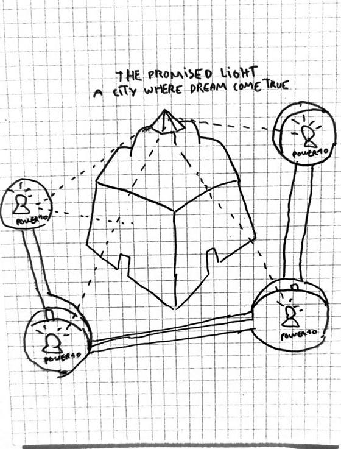</a>
  <a href="sketches/01-walls-and-doors.jpg">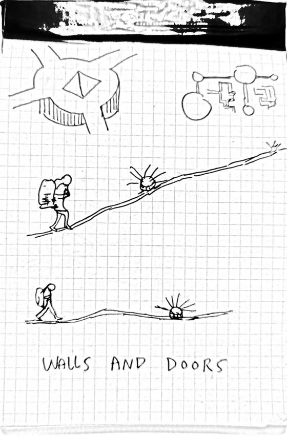</a>
  <a href="sketches/02-lamp-visit-energy-levels.jpg">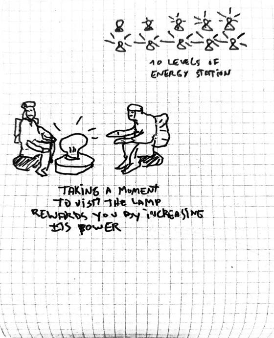</a>
  <a href="sketches/03-energy-station-marks.jpg">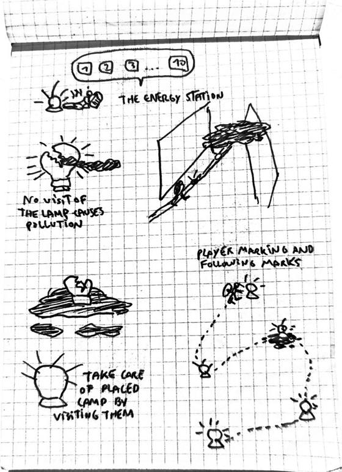</a>

  <a href="sketches/04-paths-of-lamps.jpg">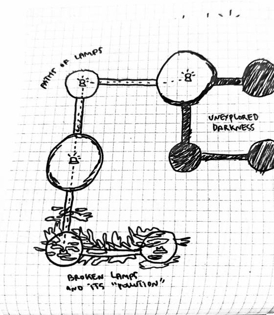</a>
  <a href="sketches/05-pollution-as-nature.jpg">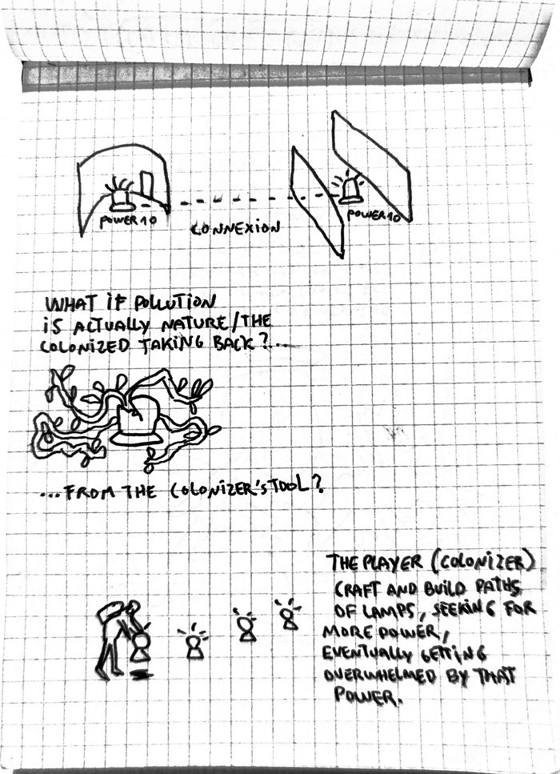</a>
  <a href="sketches/06-fluorescent-plant.jpg">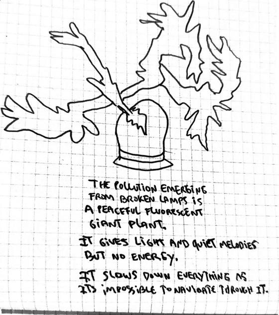</a>

### Parallel research & experimentations

*Recursive experimentations about very limited multiplayer spaces in video games.*

<table>
<tr>
<td width="50%" valign="top" align="center">
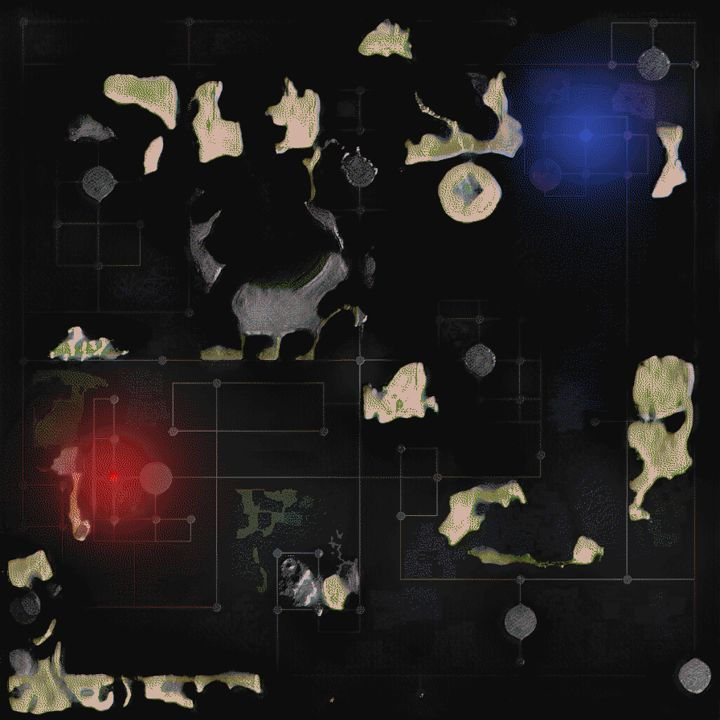 
<b>Elton Palace Project</b> (2024) 
A social game where Minecraft players have to live inside a limited area and deal with limited resources.
</td>
<td width="50%" valign="top" align="center">
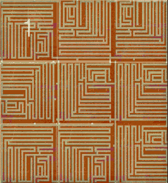 
<b>Mega Maze Adventure</b> (2022) 
A social game where you are stuck inside a maze full of zombies with other players, some areas moving from PVE to PVP without warning.
</td>
</tr>
</table>

### Other references

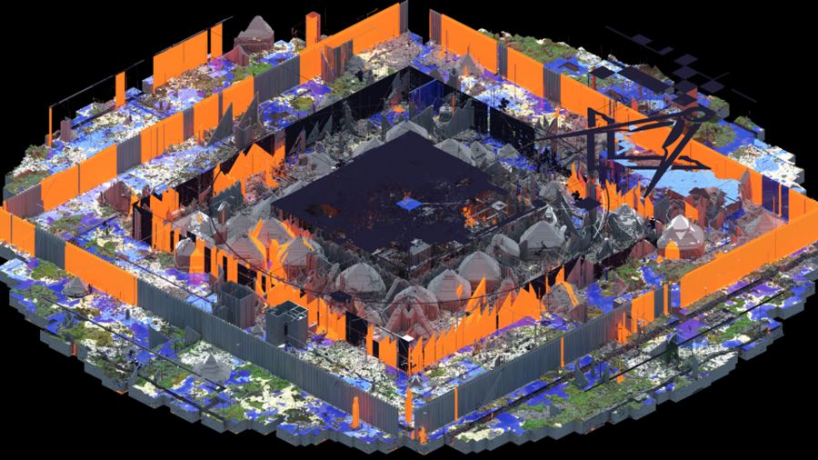 
<b>2b2t</b> (Minecraft server, 2010–) 
When the server itself becomes the cyberbully entity, rejecting new players with a nightmarish spawn: the dysfunction of the digital space. The server lacking the technical ability to host new players, the community became xenophobic in reaction.

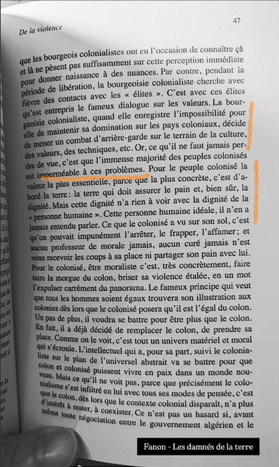 
<b>Frantz Fanon</b>, <i>Les Damnés de la Terre</i> (1961) "The colonialist bourgeoisie, when it records the impossibility for it to maintain its domination over the colonial countries, decides to wage a rearguard combat on the terrain of culture, values, techniques, etc. Now, what must never be lost sight of is that the immense majority of colonized peoples is impermeable to these problems. For the colonized people the most essential value, because the most concrete, is first of all the land: the land which will bring them bread and, certainly, dignity."

- **Sky: Children of the Light** (thatgamecompany, 2019) — talking to strangers is gated: chat benches, emotes, and friendships unlocked with candles.
